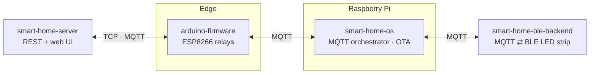

# Hi, I'm Azeem 👋

**AI/ML & Software Engineer · Agents, RAG, Robotics Software**

M.Sc. Medical Engineering (Medical Robotics), FAU Erlangen-Nürnberg. 4+ years across industrial automation software, ML pipelines and applied GenAI. Nürnberg, Germany.

I start from the whole system: what talks to what, where state lives, what fails first. Then I build it until it runs on real hardware or real users. The repos below are organised the same way, each with an architecture diagram and the reasoning behind its shape.

📫 [LinkedIn](https://linkedin.com/in/azeem-ur-rehman-47525a170) · rehmanazeem915@gmail.com

---

## 🧭 Systems I've built

### A home that runs on its own protocols
Five layers, one system, each repo owning a different transport. No cloud dependency: the Raspberry Pi is the brain.

[**smart-home-os**](https://github.com/rehmanazeem/smart-home-os) · [**smart-home-server**](https://github.com/rehmanazeem/smart-home-server) · [**smart-home-ble-backend**](https://github.com/rehmanazeem/smart-home-ble-backend) · [**arduino-firmware**](https://github.com/rehmanazeem/arduino-firmware)

### LLM systems that stay local, grounded and observable
| Project | Shape |
|---|---|
| [**llmops-langchain**](https://github.com/rehmanazeem/llmops-langchain) | FastAPI service around LangChain + Ollama, Qdrant retrieval, every call traced in LangSmith. |
| [**research-paper-assistant**](https://github.com/rehmanazeem/research-paper-assistant) | Screens and summarises Scopus exports with a local Llama, scored by an evaluation harness. |
| [**cover-letter-assistant**](https://github.com/rehmanazeem/cover-letter-assistant) | Job description + CV in, tailored letter out, fully offline on Ollama. |
| [**patient-copilot**](https://github.com/rehmanazeem/patient-copilot) | Explains a patient's own report and refuses to go beyond it. Model behind a protocol, bounded per-visitor memory. |

### Craft: small tools, built properly
| Project | Shape |
|---|---|
| [**browser-automation-toolkit**](https://github.com/rehmanazeem/browser-automation-toolkit) | Page objects with descriptor selectors, `@retry` / `@timed` decorators, composable tasks on Playwright. |
| [**backpack-nest**](https://github.com/rehmanazeem/backpack-nest) | Travel-tips API: scrypt passwords, hashed revocable tokens, filterable feed. A 2019 PHP app rebuilt without its security holes. |
| [**excel-brand-filter**](https://github.com/rehmanazeem/excel-brand-filter) | One typed core behind a CLI and a Tk GUI; messy brand names in, clean slice out. |

### In progress
[**il-pusht-k8s**](https://github.com/rehmanazeem/il-pusht-k8s): imitation learning on PushT (LeRobot, Apple Silicon), heading toward a ROS2 bridge and Kubernetes deployment with CI and monitoring. Learning-scale by design, and labelled that way.

---

## 🛠️ Toolbox
**Languages:** Python (expert), C++, SQL
**AI / GenAI:** RAG, LangChain, LangSmith, Qdrant, Ollama, AWS Bedrock, Azure OpenAI
**ML:** PyTorch, scikit-learn, OpenCV, MediaPipe, pandas / NumPy, MLflow, Optuna
**Backend:** FastAPI, Flask, asyncio, MQTT, sockets
**Frontend:** PySide6 / Qt
**Hardware / Robotics:** Modbus, CAN, TCP/IP, BLE, ESP8266, coordinate transforms, state machines
**DevOps:** Docker, Kubernetes, CI/CD, Git

## 🌱 Now
Agentic frameworks · MLOps · cloud (Azure / AWS) · reusable Claude skills and context-engineering workflows for day-to-day development.

## 🏆 Recognition & learning
- NASA SpaceApps Challenge, Top 30 Global Finalist (2021)
- Generative AI with Large Language Models, DeepLearning.AI + AWS (2023)
- Develop Generative AI Solutions with Azure OpenAI, Microsoft (2024)
